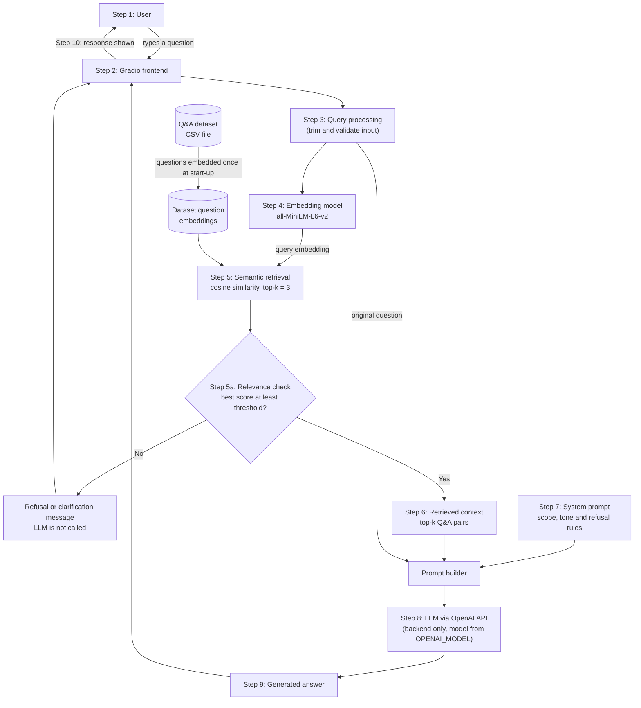

# FinWiseIQ

**FinWiseIQ: An AI-Powered RAG-Based Islamic Finance and Malaysian Financial Compliance Assistant**

> *Understand Finance. Navigate Compliance.*

CSC649 – Special Topics in Computer Science · Group 03

> [!IMPORTANT]
> **Project status: planning stage.** This repository contains planning files only (`README.md`, `.gitignore`, `.env.example`, `requirements.txt`). There is no source code, dataset or test yet. This README describes the **intended** design so the team can build against a shared plan. Every component is marked with its current status, and the README will be updated as work is merged.

> [!WARNING]
> FinWiseIQ is an **educational information assistant**. It is not a substitute for professional legal, financial, regulatory or Shariah advice. It does not certify compliance, issue Shariah rulings, or perform customer identity verification.

---

## Table of Contents

1. [Project Overview](#1-project-overview)
2. [Project Objectives](#2-project-objectives)
3. [Project Scope](#3-project-scope)
4. [Key Features](#4-key-features)
5. [Technology Stack](#5-technology-stack)
6. [System Architecture](#6-system-architecture)
7. [RAG Pipeline](#7-rag-pipeline)
8. [Dataset and Knowledge Sources](#8-dataset-and-knowledge-sources)
9. [Installation and Setup](#9-installation-and-setup)
10. [Environment Variables](#10-environment-variables)
11. [Project Structure](#11-project-structure)
12. [Evaluation and Testing](#12-evaluation-and-testing)
13. [GitHub Collaboration](#13-github-collaboration)
14. [Limitations](#14-limitations)
15. [Future Improvements](#15-future-improvements)
16. [Team Members](#16-team-members)
17. [References](#17-references)

---

## 1. Project Overview

### The problem

Islamic finance and Malaysian financial regulation are both well documented, but the documentation is long, technical and spread across several institutions. A student or new employee who wants to know what *murabahah* is, how it differs from *ijarah*, or what Customer Due Diligence involves usually has to read through policy documents that run to more than a hundred pages.

General-purpose chatbots can answer these questions quickly, but they have two weaknesses in this domain:

- They may mix up Malaysian requirements with those of other jurisdictions.
- They may give confident answers that no source supports. In a regulatory or Shariah context, that is a serious problem.

### The proposed solution

FinWiseIQ is a domain-specific chatbot that uses **Retrieval-Augmented Generation (RAG)**. Before it answers, it retrieves relevant entries from a curated question–answer dataset. The dataset will be written from authoritative documents, such as those issued by Bank Negara Malaysia (BNM), the Financial Action Task Force (FATF) and the Islamic Financial Services Board (IFSB) (see [Section 17](#17-references)). The retrieved entries are then given to a large language model (LLM) as context, and the system prompt tells the model to answer only from that context and to say when it does not know.

### Intended users and use cases

| User | Example use case |
|---|---|
| Undergraduate finance, banking or computing students | Revising Islamic finance concepts and contract types |
| New staff in banks, takaful operators or fintech companies | Getting an overview of AML/CFT and CDD obligations before reading the full policy documents |
| General public | Understanding basic terms such as *riba*, *gharar* or "Shariah-compliant" |
| Lecturers and assessors | Seeing how a small, grounded RAG system behaves compared with an unguided LLM |

---

## 2. Project Objectives

1. **Explain Islamic finance concepts.** Give clear explanations of core principles such as the prohibition of *riba* (interest), *gharar* (excessive uncertainty) and *maysir* (gambling).
2. **Explain Islamic financing contracts.** Describe common contracts (for example *murabahah*, *ijarah*, *musharakah*, *mudarabah*, *tawarruq*) and how they are used.
3. **Provide educational information on AML/CFT.** Explain the purpose of anti-money laundering and counter financing of terrorism controls and the general obligations they place on reporting institutions.
4. **Provide educational information on KYC/CDD.** Explain what Know Your Customer and Customer Due Diligence involve, including concepts such as politically exposed persons (PEPs) and enhanced due diligence.
5. **Explain the Malaysian regulatory framework.** Help users understand the role of bodies such as BNM, and key ideas such as Shariah governance.
6. **Retrieve before generating.** Ground every answer in retrieved entries from the project dataset rather than in the LLM's general knowledge.
7. **Reduce unsupported answers.** Use a system prompt and refusal behaviour so the chatbot says it does not know when the retrieved context does not support an answer.

---

## 3. Project Scope

The knowledge domain is organised into five categories. These names are intended to be used as the values of the `category` column in the dataset (see [Section 8](#8-dataset-and-knowledge-sources)).

| # | Category | Included topics (indicative) |
|---|---|---|
| 1 | **Islamic Finance Fundamentals** | *Riba*, *gharar*, *maysir*; the meaning of "Shariah-compliant"; the role of Shariah committees |
| 2 | **Islamic Financing Contracts** | *Murabahah*, *ijarah*, *musharakah*, *mudarabah*, *tawarruq*, *wakalah*; the differences between them |
| 3 | **AML/CFT** | Money laundering stages; terrorism financing; suspicious transaction reports; cash threshold reports; targeted financial sanctions; the risk-based approach |
| 4 | **KYC/CDD** | Customer identification and verification; beneficial ownership; PEPs; simplified and enhanced due diligence; record keeping |
| 5 | **Malaysian Financial Regulatory Framework** | Roles of BNM and the Securities Commission Malaysia; Shariah governance requirements; applicability of BNM policy documents |

### Outside the scope

FinWiseIQ will **not**:

- give personalised investment, financing, tax or legal advice;
- issue *fatwa* or rule on whether a specific product is Shariah-compliant;
- certify that an organisation complies with AML/CFT or any other regulation;
- verify a real person's identity, screen names against sanctions lists or process personal data;
- give live information such as current rates, prices or recent regulatory announcements;
- answer questions about other jurisdictions' regulations except where they relate to international standards (e.g. FATF).

---

## 4. Key Features

### Implemented

*None yet.* At the time of writing, the repository contains only configuration and documentation files.

### Planned

| Feature | Lecturer requirement | Status |
|---|---|---|
| Domain-specific chatbot for Islamic finance and Malaysian financial compliance | Unique domain per group | Planned |
| Custom CSV knowledge dataset with at least 30 Q&A pairs | Custom CSV dataset (≥ 30 pairs) | Planned |
| OpenAI API integration (official `openai` Python SDK, called only from the backend) | LLM/API integration | Planned |
| Custom system prompt defining scope, tone and refusal rules | Custom system prompt | Planned |
| Semantic search with Sentence Transformers (`all-MiniLM-L6-v2`) | Custom knowledge retrieval (RAG) | Planned |
| Retrieval of the top-k most relevant Q&A pairs (k = 3) | Custom knowledge retrieval (RAG) | Planned |
| Injection of retrieved Q&A pairs into the LLM prompt | Context injection | Planned |
| Gradio web interface | Frontend (Gradio/Flask/Tkinter) | Planned |
| Evaluation table of test questions and expected answers | Evaluation table | Planned |
| Out-of-scope handling: similarity threshold plus refusal instructions in the system prompt | Supports the *Refusal* evaluation dimension | Planned |
| Source-aware responses (showing which dataset entries were used) | Optional | Stretch goal |
| Conversation history within a session | Optional | Stretch goal |

---

## 5. Technology Stack

The planned dependencies are listed in [requirements.txt](requirements.txt). Nothing has been installed or tested yet. The stack follows the lecturer's CSV-based RAG example, with OpenAI as the LLM provider.

| Technology | Purpose | Where it will be used | Status |
|---|---|---|---|
| Python 3.11+ | Main programming language (pandas 3.x requires Python 3.11 or newer) | Whole project | Planned |
| pandas | Load and handle the Q&A CSV dataset | Data loading module | Planned |
| sentence-transformers (`all-MiniLM-L6-v2`) | Convert questions into embeddings; cosine similarity for semantic search | Retrieval module | Planned |
| PyTorch | Backend required by sentence-transformers | Installed automatically as a dependency | Planned |
| OpenAI API — official [`openai`](https://pypi.org/project/openai/) Python SDK | Generate answers from the retrieved context | Generation module (backend only) | Planned |
| python-dotenv | Load `OPENAI_API_KEY` and `OPENAI_MODEL` from a local `.env` file | Configuration (backend only) | Planned |
| Gradio | Web-based chat interface | Application entry point | Planned |
| pytest | Automated tests | `tests/` | Planned |
| Git and GitHub | Version control, Issues, Project board and pull requests | Collaboration | In use (repository created; no commits yet) |

### OpenAI model

| Setting | Value |
|---|---|
| Environment variable | `OPENAI_MODEL` |
| Default value in `.env.example` | `gpt-6-luna` |
| Verified | 12 November 2026, on OpenAI's official [model list](https://developers.openai.com/api/docs/models) and [model page](https://developers.openai.com/api/docs/models/gpt-6-luna). Listed as an API model ID, described as OpenAI's most efficient model for focused, high-volume tasks, with no deprecation notice, and supporting the Responses and Chat Completions endpoints. |

The model ID is read from `OPENAI_MODEL` and is not hardcoded, so it can be changed without editing code. Model IDs used by the API are not the same as ChatGPT product names. Before changing the value, or before submission, check the official model list again, because models can be deprecated.

---

## 6. System Architecture

> **All components in this diagram are planned.** None have been implemented yet.



### Component responsibilities

| # | Component | Responsibility |
|---|---|---|
| 1 | User | Asks a question in natural language. |
| 2 | Frontend (Gradio) | Accepts input and displays the response. |
| 3 | Query processing | Cleans the input (e.g. trims whitespace, rejects empty input). |
| 4 | Embedding model | Converts the user's question into a vector using `all-MiniLM-L6-v2`. |
| 5 | Semantic retrieval | Compares the query vector with the pre-computed dataset question vectors and ranks them by cosine similarity. |
| 5a | Relevance check | If even the best similarity score is below a calibrated threshold, returns a refusal or clarification message without calling the LLM (see [Section 7](#7-rag-pipeline)). |
| 6 | Retrieved context | The top-k Q&A pairs, formatted as text. |
| 7 | System prompt | Fixed instructions telling the model its role, its domain, to answer only from the context, and to refuse otherwise. |
| 8 | LLM/API | The backend calls the OpenAI API (model ID from `OPENAI_MODEL`) with the system prompt, context and question. The Gradio frontend never calls OpenAI directly and never sees the API key. |
| 9 | Generated answer | The model's text output. |
| 10 | Response display | The answer is shown in the chat interface. |

---

## 7. RAG Pipeline

> **Status: planned.** This section describes the intended baseline, based on the lecturer's CSV-based RAG example. It will be updated once the code exists.

### Steps

1. **Load the dataset.** Read the Q&A CSV file into a pandas DataFrame.
2. **Load the embedding model.** Load the Sentence Transformer model `all-MiniLM-L6-v2`.
3. **Embed the dataset questions once.** Encode every question in the dataset at start-up and keep the vectors in memory, so they are not recomputed for each query.
4. **Embed the user's question.** Encode the incoming question with the same model.
5. **Run a semantic similarity search.** Compute cosine similarity between the query vector and every dataset question vector.
6. **Retrieve the top-k pairs.** Select the k most similar Q&A pairs (initially **k = 3**).
7. **Check relevance.** If the highest similarity score is below a threshold, stop and return a refusal or clarification message instead of calling the LLM (see [Relevance threshold and refusal](#relevance-threshold-and-refusal-planned)).
8. **Inject the context.** Insert the retrieved questions and answers into the prompt sent to the LLM, together with the system prompt and the user's question.
9. **Generate a grounded response.** The LLM writes an answer using the retrieved context.

Steps 1–6, 8 and 9 follow the lecturer's baseline example. Step 7 is the team's planned addition.

### Relevance threshold and refusal (planned)

Top-k retrieval **always** returns k results, even when none of them is related to the question. If a user asks "What is the weather in Kuala Lumpur?", the retriever still returns the three least-unrelated Q&A pairs. Retrieval alone therefore cannot tell the system that it has no relevant knowledge.

To handle this, the team plans a similarity threshold:

| Best similarity score | Planned behaviour |
|---|---|
| At or above the threshold | Continue: inject the top-k pairs and call the LLM. |
| Below the threshold | Do not call the LLM. Return a fixed message saying the question is outside FinWiseIQ's knowledge, or ask the user to rephrase or be more specific. |

Notes on the design:

- **The threshold value is not yet chosen.** It must be calibrated from evaluation results: run the test set (in-scope and out-of-scope questions), record the best similarity score for each, and pick the value that best separates the two groups. A threshold that is too high refuses valid questions; one that is too low lets unrelated questions through.
- The calibrated value, and the evidence used to choose it, will be recorded in `docs/` and in this README.
- The threshold is a **first line of defence only**. A question can pass the threshold and still not be answerable from the retrieved context, so the system prompt also instructs the LLM to say it does not know in that case.
- Whether to refuse outright or ask for clarification (for example, for scores just below the threshold) will be decided during evaluation.

### Retrieval vs. generation

These are two separate stages, and they can fail in different ways:

| | Retrieval | Generation |
|---|---|---|
| **What it does** | Finds the dataset entries that are most *similar* to the question | Writes a natural-language answer from those entries |
| **Done by** | Sentence Transformer + cosine similarity (runs locally) | OpenAI LLM (remote API call from the backend) |
| **Deterministic?** | Yes, for a given model and dataset | No; output may vary between calls |
| **Typical failure** | Returns entries that look similar but do not answer the question | Adds claims not found in the context (hallucination), or ignores the context |

Keeping the stages separate makes the evaluation clearer: we can check whether retrieval found the right entries *before* judging whether the model used them correctly.

### Prompt outline (planned)

This is an outline, not final wording. The exact system prompt will be stored in the source code once written.

```text
SYSTEM:
You are FinWiseIQ, an educational assistant for Islamic finance and Malaysian
financial compliance. Answer ONLY using the context below. If the context does
not contain the answer, say that you do not know. Do not give personalised
financial, legal or Shariah advice.

CONTEXT:
Q: <retrieved question 1>
A: <retrieved answer 1>
...
Q: <retrieved question k>
A: <retrieved answer k>

USER QUESTION:
<user's question>
```

### OpenAI call (planned sketch)

The generation step will use the official OpenAI Python SDK and the Responses API. The sketch below is for illustration only. It is **not** project code yet, and the final version will be written and tested by Member 2 in `src/model.py`.

```python
# src/model.py: planned sketch, not yet implemented
import os

from dotenv import load_dotenv
from openai import OpenAI

load_dotenv()                            # reads .env into environment variables
client = OpenAI(timeout=30)              # the SDK reads OPENAI_API_KEY from the environment
MODEL = os.environ["OPENAI_MODEL"]       # e.g. gpt-6-luna; never hardcoded

def generate_answer(question: str, context: str) -> str:
    response = client.responses.create(
        model=MODEL,
        instructions=SYSTEM_PROMPT,      # the custom system prompt (src/prompt.py)
        input=f"CONTEXT:\n{context}\n\nUSER QUESTION:\n{question}",
    )
    return response.output_text
```

Design rules:

- **Backend only.** Only `src/` code calls OpenAI. The Gradio interface calls `process_question()` and receives plain text. The API key is never sent to the browser, printed, logged or shown in error messages.
- **No hardcoded secrets or model IDs.** Both come from environment variables (`OPENAI_API_KEY`, `OPENAI_MODEL`).
- **Errors.** API errors, rate limits and timeouts are caught in the backend and turned into a friendly message. The raw error is not shown to the user.

---

## 8. Dataset and Knowledge Sources

> **Status: not yet created.** There is no CSV file in the repository yet, so no dataset preview or row count is given here.

### Requirement

The lecturer requires a custom CSV dataset of **at least 30 question–answer pairs**. With five categories, a balanced target is at least 6 pairs per category.

### Proposed format

The minimum required columns are `question` and `answer`. The team proposes these additional columns so that every answer can be traced to its source:

| Column | Description | Example (format only) |
|---|---|---|
| `id` | Unique row identifier: a category prefix plus a three-digit number (see below) | `KYC-001` |
| `category` | One of the five category names in [Section 3](#3-project-scope), written exactly as shown there | `KYC/CDD` |
| `question` | The question, written as a user would ask it | — |
| `answer` | A concise answer written by the team, based on the source | — |
| `source` | Short title of the source document | — |
| `source_section` | Part, paragraph or recommendation number used | — |
| `last_reviewed` | Date the row was last checked against the source (YYYY-MM-DD) | — |

Proposed `id` prefixes and `category` values:

| `id` prefix | `category` value |
|---|---|
| `IFF` | `Islamic Finance Fundamentals` |
| `IFC` | `Islamic Financing Contracts` |
| `AML` | `AML/CFT` |
| `KYC` | `KYC/CDD` |
| `REG` | `Malaysian Financial Regulatory Framework` |

The schema is a proposal and will be finalised when the dataset is created. These column names are used throughout this README: the evaluation table in [Section 12](#12-evaluation-and-testing) refers to dataset rows by `id`.

### How answers are checked and updated (proposed process)

1. The member writing a Q&A pair fills in `source` and `source_section` with the exact document and section used.
2. A second member checks the answer against that section during pull request review.
3. Answers are paraphrased in the team's own words rather than copied at length from the source documents.
4. When a source document is replaced by a newer version, rows that cite it are reviewed again and `last_reviewed` is updated.

### Collected source documents

The team has collected the documents listed in [Section 17](#17-references), which also lists the categories that still lack a source and the action plan for closing those gaps. Their version details have not yet been verified against the official publications. The documents are stored locally **outside** this repository and are **not** committed, because they are third-party publications. (The FATF document, for example, states that it may not be reproduced without permission.) Links to the official publishers should be used instead.

---

## 9. Installation and Setup

> [!CAUTION]
> **Planned instructions — step 7 will fail if run now.** `requirements.txt` and `.env.example` now exist, but the dependency installation (step 4) has **not been tested yet**, and there is no application code. **`app.py` is a placeholder name**, not a real file, and must be replaced with the actual entry point once it exists. This notice should be removed only after every command below has been tested on a clean clone.

### Prerequisites

- Windows 10 or 11
- [Python 3.11 or newer](https://www.python.org/downloads/) (pandas 3.x requires Python 3.11+)
- [Git for Windows](https://git-scm.com/download/win)
- An OpenAI API key, created in the [OpenAI platform](https://platform.openai.com/api-keys). API usage is billed separately from any ChatGPT subscription.
- An internet connection (needed to download the embedding model on first run and to call the OpenAI API)

### Steps (PowerShell)

```powershell
# 1. Clone the repository
git clone https://github.com/nurinirdnz/csc649-group03-finwiseiq.git
cd csc649-group03-finwiseiq

# 2. Create a virtual environment
py -m venv .venv

# 3. Activate it
.\.venv\Scripts\Activate.ps1
# If PowerShell blocks the script, run this once and then try again:
#   Set-ExecutionPolicy -Scope CurrentUser RemoteSigned

# 4. Install dependencies (not yet tested)
python -m pip install --upgrade pip
pip install -r requirements.txt

# 5. Create your local .env file from the template
Copy-Item .env.example .env

# 6. Open .env and replace the OPENAI_API_KEY placeholder with your own key (see Section 10)
notepad .env

# 7. Run the application (PLACEHOLDER: app.py does not exist yet)
python app.py
```

If you use Command Prompt (`cmd.exe`) instead of PowerShell, activate the environment with `.venv\Scripts\activate.bat` and copy the file with `copy .env.example .env`.

Gradio normally prints a local URL (such as `http://127.0.0.1:7860`) when it starts. Open that URL in a browser.

---

## 10. Environment Variables

The application needs two environment variables. Both are read **only by the backend**:

| Variable | Secret? | Purpose |
|---|---|---|
| `OPENAI_API_KEY` | **Yes** | Your personal OpenAI API key. The official SDK reads it from the environment automatically. |
| `OPENAI_MODEL` | No | The OpenAI API model ID used for generation (default `gpt-6-luna`; see [Section 5](#5-technology-stack)). |

No Gemini or other provider key is needed.

### `.env.example`

[.env.example](.env.example) is committed to the repository. It contains placeholders only, never a real key:

```dotenv
OPENAI_API_KEY=your_openai_api_key_here
OPENAI_MODEL=gpt-6-luna
```

### Keeping the key secure

- Each member creates their own `.env` file locally from `.env.example`.
- `.env` and every `.env.*` file except `.env.example` are excluded by [.gitignore](.gitignore), so Git will not track them. Run `git status` before every commit to check that `.env` is not listed.
- Never put an API key in source code, notebooks, Issues, pull request descriptions, screenshots or the Gradio interface.
- The backend must not print or log the key, or include it in error messages shown to users.
- If a key is exposed or committed by mistake, **revoke it immediately in the OpenAI platform** and create a new one. Deleting the file in a later commit does not remove the key from Git history.

### `.gitignore` summary

The repository's [.gitignore](.gitignore) excludes, among other things:

- secrets and credentials (`.env`, `.env.*`, key and token files);
- **all PDF files** (`*.pdf`), by team decision. This includes the third-party reference documents and the team's own generated PDFs, which are shared outside GitHub;
- Python caches, virtual environments, downloaded model files and embedding caches;
- local databases, logs, Gradio flagging data, and IDE/OS files.

It deliberately keeps `.env.example`, `requirements.txt`, source code, tests, Markdown documentation, `data/finwiseiq_dataset.csv` and `data/sources.csv` trackable.

---

## 11. Project Structure

### Current structure

The repository currently contains only configuration and documentation files. There is no application code yet:

```text
csc649-group03-finwiseiq/
├── .env.example
├── .gitignore
├── README.md
└── requirements.txt
```

The local `docs/` folder holds the project proposal PDF, which is git-ignored and shared outside GitHub.

### Planned structure

> The following layout is a proposal. Files will be added through pull requests, and this section will be updated to match.

```text
csc649-group03-finwiseiq/
├── app/                 # Gradio interface and application entry point
├── src/                 # Retrieval, prompt building and OpenAI client code (backend)
├── data/                # Q&A CSV dataset (≥ 30 pairs)
├── tests/               # Automated tests and the evaluation question set
├── docs/                # Evaluation results, design notes, screenshots
├── .env.example         # Template for environment variables (no real keys)
├── .gitignore           # Excludes .env, virtual environments, model caches
├── requirements.txt     # Python dependencies (pin exact versions once tested)
└── README.md            # Project documentation (this file)
```

| Path | Purpose |
|---|---|
| `data/` | Holds the Q&A CSV dataset. This is the knowledge base for retrieval. |
| `src/` | Core backend logic: loading the dataset, embedding, semantic search, building the prompt and calling the OpenAI API. The only place where OpenAI is called. |
| `app/` | The Gradio user interface that connects user input to the RAG pipeline. |
| `tests/` | Automated tests and the evaluation question set with expected answers. |
| `docs/` | The completed evaluation table, screenshots and any design notes for the report. |
| `README.md` | Project documentation. |
| `.env.example` | Shows which environment variables are needed, without real values. |
| `.gitignore` | Prevents secrets, virtual environments and cached models from being committed. |
| `requirements.txt` | Lists the Python packages needed to run the project. |

---

## 12. Evaluation and Testing

> **Status: not started.** There are no test questions, results or scores yet. No accuracy figures are reported here, and none should be added until the evaluation has actually been run.

### Evaluation dimensions

Each test question will be assessed on the lecturer's five dimensions:

| # | Dimension | Question asked | How it will be judged |
|---|---|---|---|
| 1 | **Retrieval** | Did the retrieved results contain the relevant answer? | Check whether the expected dataset `id` appears in the top-k results |
| 2 | **Correctness** | Is the generated answer correct? | Compare the answer with the expected answer and the source document |
| 3 | **Faithfulness** | Are the claims supported by the retrieved context? | Check that every claim in the answer appears in the retrieved context |
| 4 | **Refusal** | Does the chatbot say it does not know when the question is outside its knowledge? | Use deliberately out-of-scope questions and check for a clear refusal. Record the best similarity score for every test question so the threshold can be calibrated (see [Section 7](#7-rag-pipeline)). |
| 5 | **Usefulness** | Is the answer clear and helpful? | Team judgement of clarity and relevance |

### Planned test set

The test set should include:

- **In-scope questions** from all five categories, including some phrased differently from the dataset questions (to test semantic matching rather than exact matching);
- **Out-of-scope questions** (e.g. "Which stock should I buy?" or questions about another country's tax law) to test refusal;
- **Edge cases**, such as questions that are similar to two categories at once.

### Planned evaluation table format

| Test ID | Test question | Expected answer (summary) | Expected dataset `id` | Best similarity score | Retrieval | Correctness | Faithfulness | Refusal | Usefulness | Notes |
|---|---|---|---|---|---|---|---|---|---|---|
| T01 | *to be written* | *to be written* | *e.g. `KYC-001`, or "none" for out-of-scope* | – | – | – | – | – | – | – |

**Planned location:** the test questions and expected answers will be stored in `tests/` and the completed evaluation table in `docs/`. The exact filenames will be added here once created.

### Running tests before a pull request

Once tests exist, every member should run them locally before opening a pull request. If the team uses `pytest`, the command would be:

```powershell
.\.venv\Scripts\Activate.ps1
python -m pytest
```

`pytest` is not yet listed as a dependency. This command will not work until tests and the dependency are added.

---

## 13. GitHub Collaboration

All four members must contribute to this repository using their own GitHub accounts. The team follows the lecturer's collaboration rules:

| Rule | Practice |
|---|---|
| Individual accounts | Every member commits from their own GitHub account, with Git configured to use the email linked to that account so commits are attributed correctly. Commits should not be made on behalf of others. |
| At least 10 meaningful commits | The lecturer requires at least 10 meaningful commits. *(The team should confirm with the lecturer whether this is per member or per group.)* |
| Commits spread over time | Commits must fall on at least 5 different days, across 3 or more weeks of the project period (Weeks 5–9). |
| Issues for every task | Each task (e.g. "Write 6 Q&A pairs for KYC/CDD") has a GitHub Issue with a clear description and an assignee. |
| Project board | Issues are tracked on a GitHub Project board with columns such as *To do*, *In progress*, *In review* and *Done*. |
| Separate branches | Work is done on feature branches, never directly on `main`. |
| Reviewed pull requests | Every pull request is reviewed and approved by at least one other member before merging. |
| No force-pushing to `main` | `git push --force` to `main` is not allowed. Enable branch protection on `main` to enforce this. |
| No secrets or model files | API keys, `.env` files and downloaded model files are never committed. |
| `.gitignore` and `.env.example` | Both files are kept in the repository and kept up to date. |

### What counts as a meaningful commit

A meaningful commit makes one real, reviewable change and has a message that says what changed. For example:

- adding or correcting a set of Q&A pairs, with their sources;
- implementing or fixing part of the retrieval, prompt or interface code;
- adding test questions or recording evaluation results;
- updating documentation to reflect work that was actually done.

Commits that exist only to raise the count, such as whitespace changes, empty commits or splitting one change into many trivial commits, are **not** meaningful and should not be made. The commit spread across Weeks 5–9 should come naturally from planning the work in small Issues and working on them steadily, not from timing commits artificially.

To check each member's commit history locally:

```powershell
# Number of commits per author
git shortlog -sn --all

# Dates of each commit by author, to check the spread across days and weeks
git log --all --format="%ad  %an  %s" --date=short
```

### Suggested workflow

```powershell
# Start from an up-to-date main branch
git checkout main
git pull origin main

# Create a branch for your Issue (example: Issue #12)
git checkout -b feature/12-kyc-dataset

# Make changes, then check what is staged. Make sure .env is NOT listed.
git add <files>
git status
git commit -m "Add KYC/CDD Q&A pairs (#12)"

# Push your branch and open a pull request on GitHub
git push -u origin feature/12-kyc-dataset
```

In the pull request description, write `Closes #12` so the Issue closes automatically when the pull request is merged.

### Before opening a pull request

1. Pull the latest `main` and resolve any conflicts on your branch.
2. Run the tests (once they exist; see [Section 12](#12-evaluation-and-testing)).
3. Run the app locally and check that your change works.
4. Run `git status` and confirm that `.env`, `.venv/` and model files are not staged.

### Branch naming convention (suggested)

| Prefix | Use |
|---|---|
| `feature/` | New functionality (e.g. `feature/8-gradio-ui`) |
| `data/` | Dataset additions or corrections (e.g. `data/15-aml-pairs`) |
| `docs/` | Documentation changes (e.g. `docs/3-readme`) |
| `fix/` | Bug fixes |

---

## 14. Limitations

### Current limitations

- **No implementation yet.** The project is at the planning stage. None of the features described above can be demonstrated yet.
- **No dataset yet.** Domain coverage cannot be measured until the CSV dataset has been written.

### Anticipated limitations of the planned design

- **Limited coverage.** A dataset of around 30 or more Q&A pairs covers only a small part of five broad topics. Many reasonable questions will have no matching entry.
- **Outdated or incomplete sources.** Regulations and standards are revised over time. Answers can become outdated if the dataset is not reviewed against newer versions.
- **Retrieval errors.** The most similar question is not always the right one. Two questions can share many words but ask different things.
- **Similarity does not guarantee relevance.** A high cosine similarity score shows that two texts are semantically close, not that the retrieved answer is factually correct for the user's question. The planned threshold filters out clearly unrelated questions but cannot catch this case.
- **A single threshold is a trade-off.** Any fixed threshold will wrongly refuse some valid questions and wrongly accept some unrelated ones. Its value depends on the size and wording of the dataset and should be re-calibrated whenever the dataset changes significantly.
- **Questions are matched, not answers.** The baseline embeds dataset *questions* only. A user question that matches the content of an answer but not the wording of its question may be missed.
- **LLM hallucination.** Even with context injection and a strict system prompt, the LLM can still add unsupported details or misread the context.
- **External API dependence and cost.** The chatbot depends on the OpenAI API being available. Rate limits, quotas, latency, usage charges and model deprecations are outside the team's control.
- **General-purpose embedding model.** `all-MiniLM-L6-v2` is trained mainly on general English text. It may represent Arabic-derived Islamic finance terms (e.g. *tawarruq*, *wa'd*) or Malay terms less accurately.
- **Human verification is required.** Regulatory and Shariah-related information must be checked by qualified people before anyone relies on it.

---

## 15. Future Improvements

These are ideas for after the baseline is complete. None are implemented.

- Show the source document and section for each answer (source-aware responses).
- Refine the baseline similarity threshold: for example, separate thresholds per category, or a re-ranking step that checks whether each retrieved answer actually addresses the question.
- Embed answers as well as questions, or combine semantic and keyword search (hybrid retrieval).
- Add multi-turn conversation history.
- Expand the dataset and add a scheduled review against new versions of the source documents.
- Retrieve directly from chunks of the source documents rather than only from a hand-written Q&A dataset.
- Compare other embedding models, including multilingual ones, for Malay and Arabic terms.
- Support questions and answers in Bahasa Melayu.
- Automate parts of the evaluation (e.g. retrieval hit rate over the test set).
- Deploy a public demo (e.g. on Hugging Face Spaces) with the API key stored as a secret.

---

## 16. Team Members

| Member name | GitHub username | Assigned role | Main responsibilities |
|---|---|---|---|
| **Nurin Irdina** | **@nurinirdnz** | **Team Leader / Backend Developer — RAG & System Integration** | Lead project planning and technical decisions; design the system architecture; develop CSV data loading, text embeddings and semantic retrieval using Sentence Transformers; implement cosine similarity, top-3 retrieval and relevance threshold; develop the RAG pipeline; integrate retrieval with OpenAI generation; coordinate frontend-backend integration, GitHub collaboration and technical evaluation. |
| **[Member 2 name]** | **[@username]** | **Backend Developer — OpenAI LLM Integration** | Integrate the OpenAI API; develop the custom system prompt; implement context-based answer generation; handle API errors and timeouts; implement response validation and domain restrictions; carry out LLM testing and evaluation. |
| **[Member 3 name]** | **[@username]** | **Domain Specialist / Knowledge Base Developer** | Research Islamic finance and Malaysian financial regulatory sources; develop and maintain the custom CSV question-and-answer dataset; organise knowledge categories; verify factual accuracy, paraphrasing and source references; maintain the source registry. |
| **[Member 4 name]** | **[@username]** | **Frontend Developer — Gradio & Testing** | Develop the Gradio chatbot interface; implement chat input and response display; integrate the frontend with the backend; handle loading states and error messages; conduct interface and end-to-end testing; assist with evaluation documentation. |

### Team Collaboration

All team members are expected to contribute to testing, debugging, documentation and final project evaluation.

Each member will:
- Work on assigned GitHub Issues.
- Use individual feature branches.
- Make meaningful commits through their own GitHub account.
- Submit pull requests for review by another team member.
- Participate in code reviews, integration and testing.

---

## 17. References

### A. Collected sources

The team has collected local copies of the following documents. The dataset will be written from them. They are kept **outside** this repository and are not redistributed here.

> [!NOTE]
> **Version details need verification.** The reference numbers and dates below were taken from the title pages of the team's local copies. They have **not yet been checked against the official publishers' websites**, so this README does not claim that any of these is the latest version. Before the dataset is finalised, a member should confirm each entry on the official site, record the date of the check, and change its status to *Verified*. If a newer version exists, the newer version should be obtained and the dataset rows that cite this document reviewed again.

| Issuing body | Document | Reference / date (as stated on local copy) | Relevant `category` values | Verification status |
|---|---|---|---|---|
| Bank Negara Malaysia | *Anti-Money Laundering, Countering Financing of Terrorism, Countering Proliferation Financing and Targeted Financial Sanctions for Financial Institutions (AML/CFT/CPF and TFS for FIs)* | BNM/RH/PD 030-14; issued 5 February 2024 | `AML/CFT`; `KYC/CDD`; `Malaysian Financial Regulatory Framework` | Not yet verified |
| Bank Negara Malaysia | *Anti-Money Laundering, Countering Financing of Terrorism and Targeted Financial Sanctions for Designated Non-Financial Businesses and Professions (DNFBPs) & Non-Bank Financial Institutions (NBFIs)* | BNM/FIED/DNFBP; issued 31 December 2019 | `AML/CFT`; `KYC/CDD` | Not yet verified |
| Bank Negara Malaysia | *Shariah Governance* (policy document) | BNM/RH/PD 028-100; issued 20 September 2019 | `Islamic Finance Fundamentals`; `Malaysian Financial Regulatory Framework` | Not yet verified |
| Financial Action Task Force | *International Standards on Combating Money Laundering and the Financing of Terrorism & Proliferation: The FATF Recommendations* | Adopted February 2012; local copy marked "Updated June 2026" | `AML/CFT`; `KYC/CDD` | Not yet verified |
| Islamic Financial Services Board | *IFSB-31: Guiding Principles for Effective Supervision of Shariah Governance* | Dated July 2025 | `Islamic Finance Fundamentals`; `Malaysian Financial Regulatory Framework` | Not yet verified |

Official publisher websites for verification: [Bank Negara Malaysia](https://www.bnm.gov.my/), [FATF](https://www.fatf-gafi.org/) and [IFSB](https://www.ifsb.org/).

### B. Sources under consideration (not yet collected)

These are **areas where a source is still needed**, not references. No specific document has been chosen or consulted for them yet, so no titles, dates or links are given. They will move to table A only once a document has been obtained and checked.

| Needed for | What is being looked for | Status |
|---|---|---|
| `Islamic Financing Contracts` | An authoritative document covering individual contracts such as *murabahah*, *ijarah*, *musharakah*, *mudarabah* and *tawarruq*. BNM's Shariah policy documents on specific contracts are one possible place to look. | Not yet identified |
| `Malaysian Financial Regulatory Framework` (capital market aspects) | A Securities Commission Malaysia (SC) publication, if the dataset will include SC-related content | Not yet identified |

### C. Source coverage action plan

Every category must be backed by at least one authoritative, verified source before its Q&A pairs are written. Each action below should become a GitHub Issue.

| `category` | Collected source(s) | Coverage | Action needed |
|---|---|---|---|
| `Islamic Finance Fundamentals` | BNM *Shariah Governance*; IFSB-31 | **Partial.** Both documents focus on governance, not on core principles such as *riba*, *gharar* and *maysir*. | Identify an authoritative source that explains the core principles. |
| `Islamic Financing Contracts` | None | **Gap** | Identify and collect authoritative source(s) for each contract to be covered (see table B). |
| `AML/CFT` | BNM AML/CFT/CPF and TFS for FIs; BNM AML/CFT and TFS for DNFBPs and NBFIs; FATF Recommendations | Collected | Verify versions (table A). |
| `KYC/CDD` | Same three documents as `AML/CFT` | Collected | Verify versions (table A). |
| `Malaysian Financial Regulatory Framework` | BNM documents above; IFSB-31 | **Partial.** No document describing the overall roles of BNM and the SC. | Decide whether SC content is in scope; if so, identify an SC source (table B). |

### Tools and libraries (planned)

- Sentence Transformers documentation: <https://www.sbert.net/>
- Gradio documentation: <https://www.gradio.app/docs>
- OpenAI API documentation: <https://developers.openai.com/api/docs/quickstart>
- OpenAI model list (check model IDs here): <https://developers.openai.com/api/docs/models>
- OpenAI Python SDK: <https://pypi.org/project/openai/>

---

*This README was last updated at the planning stage, before any code was committed. Update the status labels as features are completed.*
