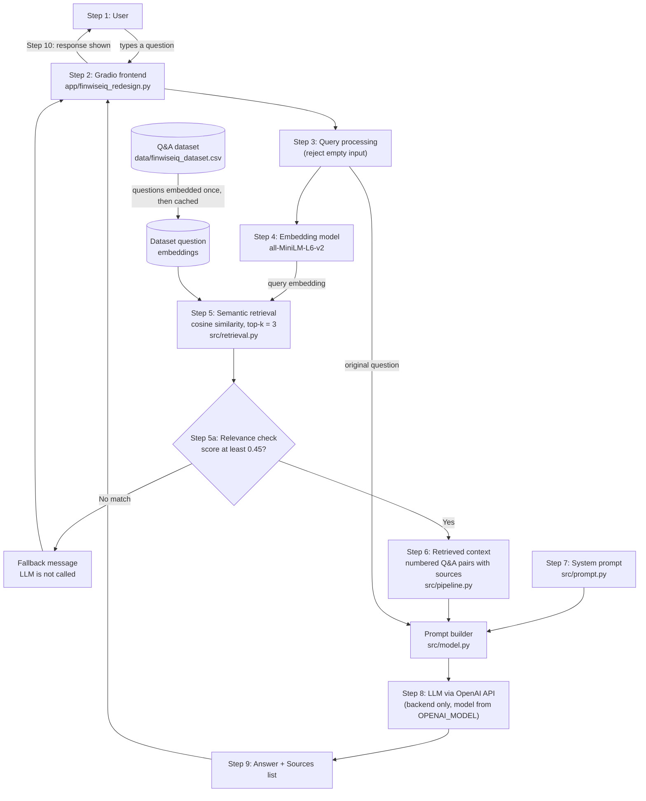

# FinWiseIQ

**FinWiseIQ: An AI-Powered RAG-Based Islamic Finance and Malaysian Financial Compliance Assistant**

> _Understand Finance. Navigate Compliance._

CSC649 – Special Topics in Computer Science · Group 03

> [!IMPORTANT]
> **Project status: implemented and evaluated.** The dataset, retrieval, OpenAI generation, end-to-end pipeline and Gradio interface are built, covered by automated tests, and evaluated end to end on 20 test questions (see [Section 12](#12-evaluation-and-testing)).

> [!WARNING]
> FinWiseIQ is an **educational information assistant**. It is not a substitute for professional legal, financial, regulatory or Shariah advice. It does not certify compliance, issue Shariah rulings, or perform customer identity verification.

---

## Table of Contents

1. [Project Overview](#1-project-overview)
2. [Project Objectives](#2-project-objectives)
3. [Project Scope](#3-project-scope)
4. [Key Features](#4-key-features)
5. [Technology Stack](#5-technology-stack)
6. [System Architecture](#6-system-architecture)
7. [RAG Pipeline](#7-rag-pipeline)
8. [Dataset and Knowledge Sources](#8-dataset-and-knowledge-sources)
9. [Installation and Setup](#9-installation-and-setup)
10. [Environment Variables](#10-environment-variables)
11. [Project Structure](#11-project-structure)
12. [Evaluation and Testing](#12-evaluation-and-testing)
13. [GitHub Collaboration](#13-github-collaboration)
14. [Limitations](#14-limitations)
15. [Future Improvements](#15-future-improvements)
16. [Team Members](#16-team-members)
17. [References](#17-references)

---

## 1. Project Overview

### The problem

Islamic finance and Malaysian financial regulation are both well documented, but the documentation is long, technical and spread across several institutions. A student or new employee who wants to know what _murabahah_ is, how it differs from _ijarah_, or what Customer Due Diligence involves usually has to read through policy documents that run to more than a hundred pages.

General-purpose chatbots can answer these questions quickly, but they have two weaknesses in this domain:

- They may mix up Malaysian requirements with those of other jurisdictions.
- They may give confident answers that no source supports. In a regulatory or Shariah context, that is a serious problem.

### The solution

FinWiseIQ is a domain-specific chatbot that uses **Retrieval-Augmented Generation (RAG)**. Before it answers, it retrieves relevant entries from a curated question–answer dataset written from authoritative documents issued by Bank Negara Malaysia (BNM), the Financial Action Task Force (FATF), the Islamic Financial Services Board (IFSB), the Securities Commission Malaysia and Malaysian legislation (see [Section 17](#17-references)). The retrieved entries are given to a large language model (LLM) as context, and the system prompt tells the model to answer only from that context and to say when it does not know. Every answer is shown with the sources it was based on.

### Intended users and use cases

| User                                                       | Example use case                                                                            |
| ---------------------------------------------------------- | ------------------------------------------------------------------------------------------- |
| Undergraduate finance, banking or computing students       | Revising Islamic finance concepts and contract types                                        |
| New staff in banks, takaful operators or fintech companies | Getting an overview of AML/CFT and CDD obligations before reading the full policy documents |
| General public                                             | Understanding basic terms such as _riba_, _gharar_ or "Shariah-compliant"                   |
| Lecturers and assessors                                    | Seeing how a small, grounded RAG system behaves compared with an unguided LLM               |

---

## 2. Project Objectives

1. **Explain Islamic finance concepts.** Give clear explanations of core principles such as the prohibition of _riba_ (interest), _gharar_ (excessive uncertainty) and _maysir_ (gambling).
2. **Explain Islamic financing contracts.** Describe common contracts (for example _murabahah_, _ijarah_, _musharakah_, _mudarabah_, _tawarruq_) and how they are used.
3. **Provide educational information on AML/CFT.** Explain the purpose of anti-money laundering and counter financing of terrorism controls and the general obligations they place on reporting institutions.
4. **Provide educational information on KYC/CDD.** Explain what Know Your Customer and Customer Due Diligence involve, including concepts such as politically exposed persons (PEPs) and enhanced due diligence.
5. **Explain the Malaysian regulatory framework.** Help users understand the role of bodies such as BNM, and key ideas such as Shariah governance.
6. **Retrieve before generating.** Ground every answer in retrieved entries from the project dataset rather than in the LLM's general knowledge.
7. **Reduce unsupported answers.** Use a similarity threshold, a system prompt and refusal behaviour so the chatbot says it does not know when the retrieved context does not support an answer.

---

## 3. Project Scope

The knowledge domain is organised into five categories. These names are the values of the `category` column in the dataset (see [Section 8](#8-dataset-and-knowledge-sources)).

| #   | Category                                     | Included topics (indicative)                                                                                                                                |
| --- | -------------------------------------------- | ----------------------------------------------------------------------------------------------------------------------------------------------------------- |
| 1   | **Islamic Finance Fundamentals**             | _Riba_, _gharar_, _maysir_; the meaning of "Shariah-compliant"; the role of Shariah committees                                                              |
| 2   | **Islamic Financing Contracts**              | _Murabahah_, _ijarah_, _musharakah_, _mudarabah_, _tawarruq_; the differences between them                                                                  |
| 3   | **AML/CFT**                                  | Money laundering stages; terrorism financing; suspicious transaction reports; cash threshold reports; targeted financial sanctions; the risk-based approach |
| 4   | **KYC/CDD**                                  | Customer identification and verification; beneficial ownership; PEPs; simplified and enhanced due diligence; record keeping                                 |
| 5   | **Malaysian Financial Regulatory Framework** | Roles of BNM and the Securities Commission Malaysia; Shariah governance requirements; applicability of BNM policy documents                                 |

### Outside the scope

FinWiseIQ will **not**:

- give personalised investment, financing, tax or legal advice;
- issue _fatwa_ or rule on whether a specific product is Shariah-compliant;
- certify that an organisation complies with AML/CFT or any other regulation;
- verify a real person's identity, screen names against sanctions lists or process personal data;
- give live information such as current rates, prices or recent regulatory announcements;
- answer questions about other jurisdictions' regulations except where they relate to international standards (e.g. FATF).

---

## 4. Key Features

| Feature                                                                                           | Lecturer requirement                        | Where                                                 | Status                                                   |
| ------------------------------------------------------------------------------------------------- | ------------------------------------------- | ----------------------------------------------------- | -------------------------------------------------------- |
| Domain-specific chatbot for Islamic finance and Malaysian financial compliance                    | Unique domain per group                     | Whole project                                         | Implemented                                              |
| Custom CSV knowledge dataset: **55** Q&A pairs in 5 categories, each with source and section         | Custom CSV dataset (≥ 30 pairs)             | `data/finwiseiq_dataset.csv`                          | Implemented                                              |
| OpenAI API integration (official `openai` Python SDK, called only from the backend)               | LLM/API integration                         | `src/model.py`                                        | Implemented                                              |
| Custom system prompt defining scope, tone and refusal rules                                       | Custom system prompt                        | `src/prompt.py`                                       | Implemented                                              |
| Semantic search with Sentence Transformers (`all-MiniLM-L6-v2`) and cosine similarity             | Custom knowledge retrieval (RAG)            | `src/retrieval.py`                                    | Implemented                                              |
| Retrieval of the top-k most relevant Q&A pairs (k = 3)                                            | Custom knowledge retrieval (RAG)            | `src/retrieval.py`                                    | Implemented                                              |
| Injection of retrieved Q&A pairs into the LLM prompt                                              | Context injection                           | `src/pipeline.py`, `src/model.py`                     | Implemented                                              |
| Gradio web interface (branded FinWiseIQ design, suggested questions, disclaimer footer)           | Frontend (Gradio/Flask/Tkinter)             | `app/finwiseiq_redesign.py`, `app/interface.py`       | Implemented                                              |
| Evaluation table of test questions and expected answers                                           | Evaluation table                            | `tests/evaluation_questions.csv`, `docs/`             | Implemented                                              |
| Out-of-scope handling: similarity threshold (0.45) plus refusal instructions in the system prompt | Supports the _Refusal_ evaluation dimension | `src/retrieval.py`, `src/prompt.py`                   | Implemented                                              |
| Source-aware responses: each answer lists the source documents and sections used                  | Optional                                    | `src/pipeline.py`                                     | Implemented                                              |
| Friendly error messages for empty input, API failures and timeouts (no raw errors or keys shown)  | Robustness                                  | `src/model.py`, `src/pipeline.py`, `app/interface.py` | Implemented                                              |
| Automated tests run on every pull request (GitHub Actions)                                        | Quality                                     | `.github/workflows/tests.yml`                         | Implemented                                              |
| Conversation memory: follow-ups such as "tell me more" or "terangkan lagi" reuse the last answered topic | Optional                         | `src/pipeline.py`                                     | Implemented (last 6 messages, rule-based)                |
| Friendly small-talk replies ("oh ok", "hmm", "thanks", "bye") in English or Malay, matching the conversation language | Usability            | `src/pipeline.py`                                     | Implemented (fixed phrase lists)                         |
| Out-of-scope message in Malay when the question contains common Malay words                       | Usability                                   | `src/pipeline.py`                                     | Implemented                                              |
| Answering questions written in Malay                                                              | –                                           | `src/retrieval.py`, `src/prompt.py`                   | Partial: works when the key term is the same in both languages (e.g. "Apa itu takaful?"); Malay-only wording often fails retrieval (see [Section 14](#14-limitations)) |

---

## 5. Technology Stack

Dependencies are listed in [requirements.txt](requirements.txt). The stack follows the lecturer's CSV-based RAG example, with OpenAI as the LLM provider.

| Technology                                                                                       | Purpose                                                                       | Where it is used                        |
| ------------------------------------------------------------------------------------------------ | ----------------------------------------------------------------------------- | --------------------------------------- |
| Python 3.11+                                                                                     | Main programming language (pandas 3.x requires Python 3.11 or newer)          | Whole project                           |
| pandas                                                                                           | Load the Q&A CSV dataset                                                      | `src/retrieval.py`                      |
| sentence-transformers (`all-MiniLM-L6-v2`)                                                       | Embed questions; cosine similarity for semantic search                        | `src/retrieval.py`                      |
| PyTorch                                                                                          | Backend required by sentence-transformers                                     | Installed automatically as a dependency |
| OpenAI API — official [`openai`](https://pypi.org/project/openai/) Python SDK (Chat Completions) | Generate answers from the retrieved context                                   | `src/model.py` (backend only)           |
| python-dotenv                                                                                    | Load `OPENAI_API_KEY` and `OPENAI_MODEL` from a local `.env` file             | `src/model.py`                          |
| Gradio                                                                                           | Web-based chat interface                                                      | `app/finwiseiq_redesign.py`                      |
| pytest                                                                                           | Automated tests                                                               | `tests/`                                |
| GitHub Actions                                                                                   | Run the test suite on every pull request to `main`                            | `.github/workflows/tests.yml`           |
| Git, GitHub and Jira                                                                             | Version control, pull requests and code review (GitHub); task tracking (Jira) | Collaboration                           |

### OpenAI model

| Setting                         | Value                                                                                                                                                                                                                                                                                                                                                |
| ------------------------------- | ---------------------------------------------------------------------------------------------------------------------------------------------------------------------------------------------------------------------------------------------------------------------------------------------------------------------------------------------------- |
| Environment variable            | `OPENAI_MODEL`                                                                                                                                                                                                                                                                                                                                       |
| Default value in `.env.example` | `gpt-6-luna`                                                                                                                                                                                                                                                                                                                                         |
| Verified                        | 12 November 2026, on OpenAI's official [model list](https://developers.openai.com/api/docs/models) and [model page](https://developers.openai.com/api/docs/models/gpt-6-luna). Listed as an API model ID, with no deprecation notice, and supporting the Responses and Chat Completions endpoints. Live API tests passed on 17 and 24 November 2026. |

The model ID is read from `OPENAI_MODEL` and is not hardcoded, so it can be changed without editing code. Model IDs used by the API are not the same as ChatGPT product names. Before changing the value, or before submission, check the official model list again, because models can be deprecated.

---

## 6. System Architecture



### Component responsibilities

| #   | Component          | File                                  | Responsibility                                                                                                                                                                                                                                                |
| --- | ------------------ | ------------------------------------- | ------------------------------------------------------------------------------------------------------------------------------------------------------------------------------------------------------------------------------------------------------------- |
| 1   | User               | –                                     | Asks a question in natural language.                                                                                                                                                                                                                          |
| 2   | Frontend (Gradio)  | `app/finwiseiq_redesign.py`, `app/interface.py` | Displays responses and passes questions and chat history through `respond()` and `get_backend_answer()` to `process_question()`. Handles greetings locally and shows friendly errors. |
| 3   | Query processing   | `app/finwiseiq_redesign.py`, `app/interface.py`, `src/pipeline.py` | Trims whitespace and rejects empty input with a short prompt to type a question, without calling the backend.                                                                                                                                                                                         |
| 4   | Embedding model    | `src/retrieval.py`                    | Converts the user's question into a normalised vector using `all-MiniLM-L6-v2`.                                                                                                                                                                               |
| 5   | Semantic retrieval | `src/retrieval.py`                    | `retrieve_context()` compares the query vector with the cached dataset question vectors and ranks them by cosine similarity.                                                                                                                                  |
| 5a  | Relevance check    | `src/retrieval.py`, `src/pipeline.py` | Only matches scoring ≥ 0.45 are kept. If none are left, `process_question()` returns a fallback message without calling OpenAI.                                                                                                                               |
| 6   | Retrieved context  | `src/pipeline.py`                     | `format_context()` turns the matches into numbered text blocks with question, answer and source.                                                                                                                                                              |
| 7   | System prompt      | `src/prompt.py`                       | `SYSTEM_PROMPT`: role, five-category domain, answer only from context, refusal rules.                                                                                                                                                                         |
| 8   | LLM/API            | `src/model.py`                        | `generate_answer()` sends the system prompt, context and question to the OpenAI Chat Completions API. Errors become a `GenerationError` with a safe message; logged errors have the API key redacted. The frontend never calls OpenAI and never sees the key. |
| 9   | Generated answer   | `src/pipeline.py`                     | The answer plus a de-duplicated "Sources:" list (document and section).                                                                                                                                                                                       |
| 10  | Response display   | `app/finwiseiq_redesign.py`           | The answer is shown in the chat interface.                                                                                                                                                                                                                    |

---

## 7. RAG Pipeline

### Steps

1. **Load the dataset.** Read `data/finwiseiq_dataset.csv` into a pandas DataFrame (`load_dataset()`).
2. **Load the embedding model.** Load `all-MiniLM-L6-v2` once and cache it (`get_model()`).
3. **Embed the dataset questions once.** Encode every dataset question (normalised) and cache the vectors in memory (`get_index()`), so they are not recomputed for each query.
4. **Embed the user's question.** Encode the incoming question with the same model.
5. **Run a semantic similarity search.** Because the vectors are normalised, the dot product equals cosine similarity.
6. **Retrieve the top-k pairs.** Select the 3 most similar Q&A pairs (`TOP_K = 3`).
7. **Check relevance.** Drop matches below `THRESHOLD = 0.45`. If nothing is left, return the fallback message and do not call the LLM.
8. **Inject the context.** Format the matches as numbered Q&A blocks with their sources, and send them with the system prompt and the user's question to OpenAI.
9. **Generate a grounded response.** The LLM writes an answer using the retrieved context. The pipeline appends the list of sources used.

Steps 1–6, 8 and 9 follow the lecturer's baseline example. Step 7 and the source list are the team's additions.

### Conversation memory and small talk (KAN-47)

Before retrieval, `process_question()` handles two extra cases, and it also picks the language of the out-of-scope message:

- **Small talk.** Messages such as "oh ok", "oo macam tu", "hmm", "thanks", "terima kasih" or "bye" get a friendly reply from `small_talk_reply()` without retrieval or an OpenAI call. A message counts as small talk only if the **whole** message is one of the listed English or Malay phrases, so "ok what is ijarah?" is still treated as a question. Thinking sounds of any length ("hmmm", "umm") are recognised with a regular expression, also when mixed with small talk ("hm ok"). Words used in both languages ("ok", "hmm", "tq", "bye") are answered in Malay if the user's last real message contained common Malay words (`conversation_is_malay()`, a rule-based check).
- **Follow-ups.** The topic is the user's last question that received a real answer (a reply with sources), so small talk and refused questions never replace it. A pure follow-up ("tell me more", "terangkan lagi") or a question that refers back ("How is it different from ijarah?") is searched together with that topic. Only then are the last six messages (each cut to 500 characters, sources removed) sent to OpenAI under "CONVERSATION SO FAR". New questions are sent on their own.
- **Malay out-of-scope message.** If nothing passes the threshold and the question contains common Malay words (including short forms such as "mcm", "nak", "dlm"), the fallback is shown in Malay (`FALLBACK_MESSAGE_MS`) and suggests asking in English for better results. OpenAI is still not called.

The memory exists only inside the open chat. Nothing is saved after the page is closed or **Clear** is pressed.

These behaviours were checked on 25 November 2026 with real retrieval and OpenAI replaced by a stub (no API calls); see [docs/pipeline_test_results.md](docs/pipeline_test_results.md#kan-47-conversation-memory-and-small-talk-25-november-2026).

### Function contract

| Function                             | File               | Input                            | Output                                                                                                                                                      |
| ------------------------------------ | ------------------ | -------------------------------- | ----------------------------------------------------------------------------------------------------------------------------------------------------------- |
| `retrieve_context(question)`         | `src/retrieval.py` | question text                    | list of up to 3 dicts (`id`, `category`, `question`, `answer`, `source`, `source_section`, `score`), best first; empty list if nothing passes the threshold |
| `generate_answer(question, context)` | `src/model.py`     | question text, formatted context | answer text; raises `GenerationError` (safe message) on API failure, `ValueError` on empty input                                                            |
| `process_question(question, history=None)` | `src/pipeline.py`  | question text, optional chat history | always returns text (small-talk reply, answer with sources, fallback, or error message); never raises                                              |

### Relevance threshold and refusal

Top-k retrieval **always** returns k results, even when none of them is related to the question. A similarity threshold is therefore used:

| Best similarity score | Behaviour                                                                                                                                                                                                                                              |
| --------------------- | ------------------------------------------------------------------------------------------------------------------------------------------------------------------------------------------------------------------------------------------------------ |
| At or above 0.45      | Keep matches ≥ 0.45, inject them as context and call the LLM.                                                                                                                                                                                          |
| Below 0.45            | Do not call the LLM. Return: _"Sorry, I can only answer questions about Islamic finance and Malaysian financial compliance (AML/CFT, KYC/CDD and regulation), and I could not find relevant information for that question. Please try rephrasing it."_ If the question contains common Malay words, the same message is shown in Malay. |

**How 0.45 was chosen** (16 November 2026, details in [docs/retrieval_evaluation.md](docs/retrieval_evaluation.md)): clear off-topic test questions (weather, recipe, stock tip) scored at most **0.388**, while the lowest correct in-scope match (AML-006) scored **0.495**. A threshold of 0.5 would have dropped that valid match, so 0.45 was chosen between the two groups. After the KAN-38 dataset update (24 November 2026) the highest score among the clearly off-topic questions (T16–T18) rose to **0.409** (the recipe question against the new sukuk row), which is still below 0.45, so the threshold was kept. The two in-domain-sounding out-of-scope questions (T19 at 0.630, T20 at 0.561) pass the threshold and are refused by the system prompt instead.

The threshold is a **first line of defence only**. Questions that sound in-domain but are outside scope (for example asking for Shariah certification of a product) can pass the threshold, so the system prompt also instructs the LLM to refuse in those cases. This was confirmed in the live test (see [Section 12](#12-evaluation-and-testing)).

### Retrieval vs. generation

These are two separate stages, and they can fail in different ways:

|                     | Retrieval                                                         | Generation                                                                   |
| ------------------- | ----------------------------------------------------------------- | ---------------------------------------------------------------------------- |
| **What it does**    | Finds the dataset entries that are most _similar_ to the question | Writes a natural-language answer from those entries                          |
| **Done by**         | Sentence Transformer + cosine similarity (runs locally)           | OpenAI LLM (remote API call from the backend)                                |
| **Deterministic?**  | Yes, for a given model and dataset                                | No; output may vary between calls                                            |
| **Typical failure** | Returns entries that look similar but do not answer the question  | Adds claims not found in the context (hallucination), or ignores the context |

Keeping the stages separate makes the evaluation clearer: retrieval is evaluated on its own ([docs/retrieval_evaluation.md](docs/retrieval_evaluation.md)) before generation quality is judged.

### Prompt structure

The full system prompt is in [src/prompt.py](src/prompt.py). Each request sends two messages:

```text
SYSTEM:
<SYSTEM_PROMPT: FinWiseIQ role, five-category domain, answer ONLY from the
 CONTEXT, refuse when context is insufficient, refuse personalised advice,
 fatwa/certification, identity checks, live data and foreign regulations>

USER:
CONTEXT:
[1] Q: <retrieved question 1>
    A: <retrieved answer 1>
    Source: <source>, <section>
[2] ...
[3] ...

USER QUESTION:
<user's question>
```

### Security rules

- **Backend only.** Only `src/` code calls OpenAI. The Gradio interface calls `process_question()` and receives plain text. The API key is never sent to the browser or shown in the interface.
- **No hardcoded secrets or model IDs.** Both come from environment variables (`OPENAI_API_KEY`, `OPENAI_MODEL`).
- **Errors.** API errors, rate limits and timeouts are caught in the backend and turned into a friendly message. The raw error is not shown to the user, and the key is redacted from logged error text.

---

## 8. Dataset and Knowledge Sources

### Dataset

[data/finwiseiq_dataset.csv](data/finwiseiq_dataset.csv) contains **55 question–answer pairs across five categories**, exceeding the lecturer's minimum of 30. Full details are in [data/README.md](data/README.md).

| Column           | Description                                                     | Example                                                                    |
| ---------------- | --------------------------------------------------------------- | -------------------------------------------------------------------------- |
| `id`             | Category prefix plus a three-digit number                       | `KYC-001`                                                                  |
| `category`       | One of the five category names in [Section 3](#3-project-scope) | `KYC/CDD`                                                                  |
| `question`       | The question, written as a user would ask it                    | _What does Shariah-compliant mean in finance?_                             |
| `answer`         | A concise answer paraphrased by the team from the source        | –                                                                          |
| `source`         | Title of the source document(s)                                 | _BNM Policy Document: Shariah Governance (BNM/RH/PD 028-100, 20 Sep 2019)_ |
| `source_section` | Paragraph, section or part used                                 | _para 1.2-1.4_                                                             |
| `last_reviewed`  | Date the row was last checked against the source (YYYY-MM-DD)   | `2026-11-17`                                                               |

| `id` prefix | `category` value                           | Pairs |
| ----------- | ------------------------------------------ | ----- |
| `IFF`       | `Islamic Finance Fundamentals`             | 12    |
| `IFC`       | `Islamic Financing Contracts`              | 11    |
| `AML`       | `AML/CFT`                                  | 12    |
| `KYC`       | `KYC/CDD`                                  | 10    |
| `REG`       | `Malaysian Financial Regulatory Framework` | 10    |

### How answers were checked

1. The member writing a Q&A pair filled in `source` and `source_section` with the exact document and section used.
2. Answers were checked against the cited section, and corrected where needed (KAN-29).
3. Answers are paraphrased in the team's own words rather than copied at length from the source documents.
4. When a source document is replaced by a newer version, rows that cite it should be reviewed again and `last_reviewed` updated.

### Source documents

All 17 sources, with publisher, date and official link, are listed in [docs/source_registry.md](docs/source_registry.md) and summarised in [Section 17](#17-references). The PDF documents themselves are **not** committed, because they are third-party publications; links to the official publishers are used instead.

---

## 9. Installation and Setup

### Prerequisites

- Windows 10 or 11 (the commands below use PowerShell)
- [Python 3.11 or newer](https://www.python.org/downloads/) (pandas 3.x requires Python 3.11+)
- [Git for Windows](https://git-scm.com/download/win)
- An OpenAI API key, created in the [OpenAI platform](https://platform.openai.com/api-keys). API usage is billed separately from any ChatGPT subscription.
- An internet connection (needed to download the embedding model on first run and to call the OpenAI API)

### Steps (PowerShell)

```powershell
# 1. Clone the repository
git clone https://github.com/nurinirdnz/csc649-group03-finwiseiq.git
cd csc649-group03-finwiseiq

# 2. Create a virtual environment
py -m venv .venv

# 3. Activate it
.\.venv\Scripts\Activate.ps1
# If PowerShell blocks the script, run this once and then try again:
#   Set-ExecutionPolicy -Scope CurrentUser RemoteSigned

# 4. Install dependencies
python -m pip install --upgrade pip
pip install -r requirements.txt

# 5. Create your local .env file from the template
Copy-Item .env.example .env

# 6. Open .env and replace the OPENAI_API_KEY placeholder with your own key (see Section 10)
notepad .env

# 7. (Optional) Check the OpenAI connection. Expected: "OpenAI API connection status: OK"
python -m src.model

# 8. Run the application
python -m app.finwiseiq_redesign
```

Open the local URL that Gradio prints (normally `http://127.0.0.1:7860`) in a browser. The first question takes a few seconds longer because the embedding model is loaded. Stop the app with **Ctrl+C**.

Notes:

- Run `python -m app.finwiseiq_redesign` from the project folder so Python can find the `src` package. This opens the branded FinWiseIQ interface (KAN-39), which uses `respond()` from `app/interface.py`.
- If PowerShell blocks virtual environment activation, run `.\.venv\Scripts\python.exe -m app.finwiseiq_redesign` directly from the project folder.
- If you use Command Prompt (`cmd.exe`) instead of PowerShell, activate the environment with `.venv\Scripts\activate.bat` and copy the file with `copy .env.example .env`.
- On the first run, Hugging Face may print _"You are sending unauthenticated requests to the HF Hub"_. This is only a warning about download rate limits and can be ignored.

---

## 10. Environment Variables

The application needs two environment variables. Both are read **only by the backend** (`src/model.py`):

| Variable         | Secret? | Purpose                                                                                                   |
| ---------------- | ------- | --------------------------------------------------------------------------------------------------------- |
| `OPENAI_API_KEY` | **Yes** | Your personal OpenAI API key. OpenAI secret keys start with `sk-`.                                        |
| `OPENAI_MODEL`   | No      | The OpenAI API model ID used for generation (default `gpt-6-luna`; see [Section 5](#5-technology-stack)). |

No Gemini or other provider key is needed.

### `.env.example`

[.env.example](.env.example) is committed to the repository. It contains placeholders only, never a real key:

```dotenv
OPENAI_API_KEY=your_openai_api_key_here
OPENAI_MODEL=gpt-6-luna
```

If the placeholder is left unchanged, the app shows a friendly configuration error instead of calling OpenAI.

### Keeping the key secure

- Each member creates their own `.env` file locally from `.env.example`.
- `.env` and every `.env.*` file except `.env.example` are excluded by [.gitignore](.gitignore), so Git will not track them. Run `git status` before every commit to check that `.env` is not listed.
- A variable set in the terminal (for example `$env:OPENAI_API_KEY = "..."`) takes priority over `.env`. Remove it afterwards with `Remove-Item Env:OPENAI_API_KEY`.
- Never put an API key in source code, notebooks, Jira tasks, pull request descriptions, screenshots or the Gradio interface.
- If a key is exposed or committed by mistake, **revoke it immediately in the OpenAI platform** and create a new one. Deleting the file in a later commit does not remove the key from Git history.

### `.gitignore` summary

The repository's [.gitignore](.gitignore) excludes, among other things:

- secrets and credentials (`.env`, `.env.*`, key and token files);
- **all PDF files** (`*.pdf`), by team decision. This includes the third-party reference documents and the team's own generated PDFs, which are shared outside GitHub;
- Python caches, virtual environments, downloaded model files and embedding caches;
- local databases, logs, Gradio flagging data, and IDE/OS files.

It deliberately keeps `.env.example`, `requirements.txt`, source code, tests, Markdown documentation and `data/finwiseiq_dataset.csv` trackable.

---

## 11. Project Structure

```text
csc649-group03-finwiseiq/
├── .github/workflows/
│   └── tests.yml                  # Runs pytest on every pull request to main
├── app/
│   ├── finwiseiq_redesign.py      # Branded Gradio UI (entry point: python -m app.finwiseiq_redesign)
│   ├── finwiseiq_theme.css        # Styles for the branded UI (colours, mobile layout, reduced motion)
│   ├── assets/                    # FinWiseIQ logo and favicon
│   └── interface.py               # respond(): passes questions to the pipeline (used by the branded UI)
├── data/
│   ├── finwiseiq_dataset.csv      # Knowledge base: 55 Q&A pairs with sources
│   ├── sample.csv                 # Early placeholder rows used during setup (not used by the app)
│   └── README.md                  # Dataset columns, categories and data rules
├── docs/
│   ├── source_registry.md         # All 17 source documents with links
│   ├── retrieval_evaluation.md    # Retrieval accuracy and threshold calibration (KAN-36)
│   ├── generation_test_results.md # OpenAI generation tests (KAN-24)
│   ├── frontend_test_results.md   # Gradio interface tests and UI polish verification
│   ├── pipeline_test_results.md   # End-to-end pipeline test with the real API (KAN-34)
│   ├── end_to_end_answers.md      # Raw answers for all 20 test questions (KAN-40)
│   ├── end_to_end_evaluation.md   # Five-dimension evaluation table (KAN-40)
│   ├── generation_evaluation.md   # OpenAI answer quality evaluation (KAN-37)
│   ├── generation_evaluation_answers.md # Raw generation answers (KAN-37)
│   ├── security_review.md         # Security and repository review (KAN-42)
│   ├── chatbot_test_cases.md      # Week 9 chatbot test cases and failed cases (KAN-43)
│   ├── KAN-39_Gradio_Usability_Test_Report.md # Usability testing U01-U12 (KAN-39)
│   └── screenshots/               # Usability test screenshots (KAN-39)
├── src/
│   ├── __init__.py
│   ├── retrieval.py               # Dataset loading, embeddings, top-3 cosine search, threshold
│   ├── prompt.py                  # SYSTEM_PROMPT
│   ├── model.py                   # OpenAI client, generate_answer(), error handling
│   └── pipeline.py                # process_question(): retrieval -> context -> generation -> sources
├── tests/
│   ├── evaluation_questions.csv   # Test set T01-T20 (15 in-scope, 5 out-of-scope)
│   ├── evaluate_retrieval.py      # Retrieval evaluation script
│   ├── evaluate_end_to_end.py     # End-to-end evaluation script (real API)
│   ├── evaluate_generation.py     # Generation-only evaluation script (real API, KAN-37)
│   ├── test_retrieval.py          # Retrieval unit tests
│   ├── test_model.py              # Generation unit tests (OpenAI mocked)
│   ├── test_pipeline.py           # Pipeline unit tests (OpenAI mocked)
│   ├── test_interface.py          # Interface unit tests (backend mocked)
│   └── test_finwiseiq_redesign.py # Branded UI unit tests (backend mocked)
├── .env.example                   # Environment variable template (no real keys)
├── .gitignore
├── pytest.ini                     # pytest settings (pythonpath, testpaths)
├── requirements.txt
└── README.md
```

| Path     | Purpose                                                                                                                        |
| -------- | ------------------------------------------------------------------------------------------------------------------------------ |
| `data/`  | The Q&A CSV dataset: the knowledge base for retrieval.                                                                         |
| `src/`   | Backend logic: retrieval, system prompt, OpenAI generation and the end-to-end pipeline. The only place where OpenAI is called. |
| `app/`   | The Gradio user interface that connects user input to the pipeline.                                                            |
| `tests/` | Automated tests, the evaluation question set and the retrieval evaluation script.                                              |
| `docs/`  | Source registry and test/evaluation results.                                                                                   |

---

## 12. Evaluation and Testing

### Automated tests

The test suite has **108 tests** and runs without an API key. The tests mock OpenAI calls and backend calls where needed.

| File                      | Tests | What is checked                                                                                                                                                     |
| ------------------------- | ----- | ------------------------------------------------------------------------------------------------------------------------------------------------------------------- |
| `tests/test_retrieval.py` | 5     | Dataset loads with all columns; a missing column raises an error; relevant questions return sorted matches; off-topic and empty questions return nothing            |
| `tests/test_model.py`     | 15    | Context-grounded generation; input validation; timeout, authentication, rate-limit, connection and other API errors; key redaction in logs; empty responses; Malay queries and refusals |
| `tests/test_pipeline.py`  | 43    | Input validation, retrieval and citations, off-topic fallback, API error handling, follow-up retrieval, topic kept after small talk, small-talk replies in English and Malay, Malay/English off-topic fallback, and history limits |
| `tests/test_interface.py` | 13    | Input validation, response display, Gradio history forwarding, local greetings, backend exceptions, and invalid replies |
| `tests/test_finwiseiq_redesign.py` | 32 | Branded UI response rendering, question shown while the answer loads, welcome message, local greetings, repeated blank-input handling, Clear, suggested questions, assets, mobile layout, and reduced motion |

Run them from the project folder.

```powershell
.\.venv\Scripts\python.exe -m pytest -q
```

The same tests run automatically on every pull request through GitHub Actions, and a pull request cannot be merged into `main` unless they pass.

### Evaluation dimensions

Each test question is assessed on the lecturer's five dimensions:

| #   | Dimension        | Question asked                                                                    | How it is judged                                                          |
| --- | ---------------- | --------------------------------------------------------------------------------- | ------------------------------------------------------------------------- |
| 1   | **Retrieval**    | Did the retrieved results contain the relevant answer?                            | Check whether the expected dataset `id` appears in the top-3 results      |
| 2   | **Correctness**  | Is the generated answer correct?                                                  | Compare the answer with the expected key points and the source document   |
| 3   | **Faithfulness** | Are the claims supported by the retrieved context?                                | Check that every claim in the answer appears in the retrieved context     |
| 4   | **Refusal**      | Does the chatbot say it does not know when the question is outside its knowledge? | Out-of-scope questions should get the fallback message or a clear refusal |
| 5   | **Usefulness**   | Is the answer clear and helpful?                                                  | Team judgement of clarity and relevance                                   |

### Test set

[tests/evaluation_questions.csv](tests/evaluation_questions.csv) holds **20 test questions** (T01–T20): 15 in-scope questions from all five categories, worded differently from the dataset questions to test semantic rather than keyword matching, and 5 out-of-scope questions. Each row records the expected answer key points and the expected dataset `id`.

### Results so far

**Retrieval** (16 November 2026, re-run 24 November 2026 after the KAN-38 dataset update with the same results, [docs/retrieval_evaluation.md](docs/retrieval_evaluation.md), reproduce with `python -m tests.evaluate_retrieval`):

| Metric                              | Result         |
| ----------------------------------- | -------------- |
| In-scope: correct row at rank 1     | 12 / 15 (80%)  |
| In-scope: correct row in top 3      | 15 / 15 (100%) |
| Out-of-scope: rejected by threshold | 3 / 5          |

The two out-of-scope questions that pass the threshold (T19 Shariah certification, T20 US AML rules) sound in-domain; these are handled by the system prompt's refusal rules.

**Generation** (17 November 2026, [docs/generation_test_results.md](docs/generation_test_results.md)): live API tests with a relevant question, an insufficient-context question and an out-of-scope stock-tip question all passed.

**End-to-end pipeline** (24 November 2026, [docs/pipeline_test_results.md](docs/pipeline_test_results.md)), using the real OpenAI API:

| Question                                            | Result                                                                             |
| --------------------------------------------------- | ---------------------------------------------------------------------------------- |
| What is customer due diligence?                     | Grounded answer with three BNM AML/CFT policy document sources                     |
| Can you explain murabahah in simple words?          | Grounded answer with BNM Murabahah, Ijarah and Mudarabah sources                   |
| Write me a nasi lemak recipe                        | Fallback message; OpenAI not called                                                |
| Is my company product officially Shariah-compliant? | Declined to certify; referred the user to a qualified Shariah scholar or regulator |
| Invalid API key                                     | Friendly error message; no crash                                                   |

**Conversation memory and small talk** (25 November 2026, KAN-47, [docs/pipeline_test_results.md](docs/pipeline_test_results.md#kan-47-conversation-memory-and-small-talk-25-november-2026)): 15 scripted cases with real retrieval and OpenAI replaced by a stub. Small talk got the right English or Malay reply, follow-ups ("tell me more", "terangkan lagi", "How is it different from ijarah?") reused the earlier topic and sent history, new questions were sent without history, and off-topic questions got the English or Malay fallback. 15 / 15 behaved as designed. This checks the routing logic, not the quality of the generated answers.

**Malay retrieval check** (25 November 2026, retrieval only, no OpenAI): 10 short Malay questions were run through `retrieve_context()`. Questions whose key term is the same in both languages found the right row at rank 1 ("Apa itu ijarah / takaful / sukuk / riba?", "Apakah peranan Bank Negara Malaysia?"). Questions in Malay wording did not: "Apa itu murabahah?" ranked Mudarabah first (Murabahah rows were 2nd and 3rd), "Apa beza perbankan Islam dan konvensional?" and "Apa itu usaha wajar pelanggan?" (customer due diligence) matched the wrong rows, and "Apa maksud pengubahan wang haram?" (money laundering) and "mcm mana nak simpan duit dlm shariah-compliant way?" found nothing. This is an informal check, not part of the 20-question evaluation set.

**Gradio interface** (24 November 2026, KAN-35): through the running app, the Murabahah and customer due diligence questions returned answers with sources, off-topic questions returned the fallback, and empty input returned "Please type a question."

**Usability testing** (24 November 2026, KAN-39, [docs/KAN-39_Gradio_Usability_Test_Report.md](docs/KAN-39_Gradio_Usability_Test_Report.md)): 12 manual scenarios on the branded interface with the real backend (U01–U12: answers with sources, Send button and Enter key, suggested questions, empty input, out-of-scope refusal, chat history, Clear, API error, 390 px mobile width, keyboard and reduced motion). All 12 passed; three had minor notes: low contrast in the welcome text, limited mobile input spacing, and follow-up questions not using earlier chat context (follow-ups were later added in KAN-47). Screenshots are in `docs/screenshots/`. The time-on-task values in the report are estimates, not stopwatch measurements.

The later frontend polish improved contrast, mobile spacing, and keyboard focus. [Frontend polish verification](docs/frontend_test_results.md#frontend-ui-polish-verification)

**End-to-end evaluation** (24 November 2026, KAN-40, re-run after the KAN-38 dataset update, [docs/end_to_end_evaluation.md](docs/end_to_end_evaluation.md), reproduce with `python -m tests.evaluate_end_to_end`): all 20 test questions were run through the full pipeline with the real OpenAI API and judged on the five dimensions.

| Dimension | Result |
|---|---|
| Retrieval: in-scope, correct row in top 3 | 15 / 15 (12 at rank 1) |
| Correctness (in-scope) | 13 / 15 fully correct, 2 partial, 0 wrong |
| Faithfulness (17 generated answers) | 17 / 17 |
| Refusal (out-of-scope) | 5 / 5 (3 by the threshold, 2 by the system prompt) |
| Usefulness | 20 / 20 |

The two partial answers were T13 and T14. In both, the missing detail (the 2019 Federal Court ruling, added to REG-004 in KAN-38, and Malaysia's FATF membership) is in the retrieved row, but the model gave a short answer to a short question and left it out. Nothing was invented.

**Generation-only evaluation** (24 November 2026, KAN-37, [docs/generation_evaluation.md](docs/generation_evaluation.md), reproduce with `python -m tests.evaluate_generation`): `generate_answer()` was tested on its own, with the expected rows supplied directly and, for T16–T20, the threshold bypassed. Correctness 13 / 15 (2 partial, T13 and T14), faithfulness 20 / 20, refusal 5 / 5 (the system prompt refused every out-of-scope question even when OpenAI was called), usefulness 20 / 20.

**Chatbot test cases** (KAN-43, [docs/chatbot_test_cases.md](docs/chatbot_test_cases.md)): the Week 9 test plan covering intent recognition, response relevance, context retention, sentiment handling, task completion and user experience, with a summary table and the failed cases found. Some results are still being filled in; see the file for the current status.

---

## 13. GitHub Collaboration

All four members contribute to this repository using their own GitHub accounts. The team follows the lecturer's collaboration rules:

| Rule                            | How the team applied it                                                                                                                                              |
| ------------------------------- | -------------------------------------------------------------------------------------------------------------------------------------------------------------------- |
| Individual accounts             | Every member commits from their own GitHub account.                                                                                                                  |
| At least 10 meaningful commits  | Each commit makes one reviewable change, with a message that names the Jira task (e.g. `KAN-34: ...`) and describes what changed.                                    |
| Commits spread over time        | Commits on `main` span several days from 12 November 2026 onwards.                                                                                                   |
| Tasks tracked                   | Each task is a Jira issue in project **KAN**, grouped into five phase epics, with an assignee and a due date, moved across _To Do → In Progress → In Review → Done_. |
| Separate branches               | Work is done on feature branches (e.g. `feature/rag-retrieval`, `feature/openai-integration`, `feature/knowledge-dataset`), never directly on `main`.                |
| Reviewed pull requests          | Branch protection on `main` requires at least one approving review and a passing `tests` check before merging.                                                       |
| No force-pushing to `main`      | Protected by branch protection.                                                                                                                                      |
| No secrets or model files       | API keys, `.env` files, PDFs and downloaded model files are excluded by `.gitignore` and never committed.                                                            |
| `.gitignore` and `.env.example` | Both files are kept in the repository.                                                                                                                               |

### Workflow used

```powershell
# Start from an up-to-date main branch
git checkout main
git pull origin main

# Create a branch for the Jira task
git checkout -b feature/<short-name>

# Make changes, run the tests, then stage specific files (not "git add .")
python -m pytest
git add <files>
git status            # make sure .env is NOT listed
git commit -m "KAN-<number>: <what changed>"

# Push the branch and open a pull request on GitHub
git push -u origin feature/<short-name>
```

In the pull request, name the Jira task (e.g. `Jira: KAN-34`), describe what changed and how it was tested, and request a review from the teammate whose code it affects. If `main` has moved on, merge `origin/main` into the feature branch and re-run the tests before merging.

To check each member's commit history locally:

```powershell
git shortlog -sn --all --no-merges
git log --all --format="%ad  %an  %s" --date=short
```

---

## 14. Limitations

- **Limited coverage.** 55 Q&A pairs cover only a small part of five broad topics. Reasonable questions with no matching entry (for example _zakat_, which is not in the dataset) receive the fallback message.
- **Retrieval near-misses.** In 3 of 15 in-scope test questions, the expected row was ranked second or third rather than first (e.g. a murabahah question matched an "ijarah vs murabahah" row first). All three were still in the top 3 and therefore reached the model as context.
- **Similarity does not guarantee relevance.** A high cosine similarity score shows that two texts are semantically close, not that the retrieved answer is correct for the question. Questions that sound in-domain but are out of scope can pass the threshold and rely on the system prompt to refuse.
- **A single threshold is a trade-off.** 0.45 was calibrated on 20 test questions. It may wrongly refuse some valid questions and accept some unrelated ones, and should be re-calibrated whenever the dataset changes significantly.
- **Questions are matched, not answers.** Only dataset _questions_ are embedded. A user question that matches the content of an answer but not the wording of its question may be missed.
- **Short answers can skip details.** For short questions the model sometimes leaves out a relevant fact that is in the retrieved context (T13, T14 in the end-to-end evaluation).
- **Rule-based conversation memory and small talk.** Follow-ups, small talk and the reply language are detected with fixed word lists, not by understanding the message. Phrases that are not on the lists (for example "hmm ok la tu", or a follow-up worded in an unusual way) get the normal search and often the fallback. A Malay message containing none of the listed Malay words is treated as English. "Yes", "ya" and "boleh" are deliberately not treated as small talk. When history is used, only the last six messages are sent to OpenAI, and memory is lost when the page is closed or cleared.
- **Malay questions are only partly supported.** The dataset is in English and the embedding model is English-only, so Malay questions are found only when the key term is the same in both languages (ijarah, takaful, sukuk). Questions in Malay wording ("pengubahan wang haram", "usaha wajar pelanggan") usually match the wrong row or nothing. In that case the user gets the Malay fallback, which suggests asking in English. When a Malay question does retrieve the right rows, the model answers in Malay.
- **Chat history is sent to OpenAI for follow-ups.** For follow-up questions, up to six earlier messages are sent to the OpenAI API, so users should not type personal or confidential information.
- **LLM hallucination.** Even with context injection and a strict system prompt, the LLM can still add unsupported details or misread the context.
- **Outdated sources.** Regulations and standards are revised over time. Answers can become outdated if the dataset is not reviewed against newer versions.
- **External API dependence and cost.** The chatbot depends on the OpenAI API being available. Rate limits, quotas, latency, usage charges and model deprecations are outside the team's control.
- **General-purpose embedding model.** `all-MiniLM-L6-v2` is trained mainly on general English text. It may represent Arabic-derived Islamic finance terms or Malay terms less accurately.
- **Human verification is required.** Regulatory and Shariah-related information must be checked by qualified people before anyone relies on it.

---

## 15. Future Improvements

- Refine the similarity threshold: for example, separate thresholds per category, or a re-ranking step that checks whether each retrieved answer actually addresses the question.
- Embed answers as well as questions, or combine semantic and keyword search (hybrid retrieval).
- Replace the word lists for follow-ups, small talk and language with a more general method (for example, asking the LLM to rewrite a follow-up into a standalone question), so unlisted phrasings also work. (Keeping the topic across small talk and refusals was added in KAN-47.)
- Expand the dataset further (e.g. _zakat_; _takaful_ and _sukuk_ were added in KAN-38) and add a scheduled review against new versions of the source documents.
- Retrieve directly from chunks of the source documents rather than only from a hand-written Q&A dataset.
- Support Malay questions properly: try a multilingual embedding model (for example `paraphrase-multilingual-MiniLM-L12-v2`) or add Malay versions of the dataset questions, then re-calibrate the threshold and re-run the evaluations.
- Deploy a public demo (e.g. on Hugging Face Spaces) with the API key stored as a secret.

---

## 16. Team Members

| Member                         | GitHub username                                        | Role                                         | Main contributions                                                                                                                                                                                                                                                                                   |
| ------------------------------ | ------------------------------------------------------ | -------------------------------------------- | ---------------------------------------------------------------------------------------------------------------------------------------------------------------------------------------------------------------------------------------------------------------------------------------------------- |
| **Nurin Irdina** (Team Leader) | [@nurinirdnz](https://github.com/nurinirdnz)           | Backend Developer — RAG & System Integration | Project planning, Jira and repository setup; system architecture; dataset loading, embeddings, top-3 semantic retrieval and threshold calibration (`src/retrieval.py`); retrieval evaluation; end-to-end pipeline (`src/pipeline.py`); Gradio–backend integration; CI workflow; pull request reviews |
| **Nurisha Adilla**             | [@nurishaadilla](https://github.com/nurishaadilla)     | Backend Developer — OpenAI LLM Integration   | System prompt (`src/prompt.py`); OpenAI client and context-based answer generation with error handling (`src/model.py`); generation tests and live API testing                                                                                                                                       |
| **Syafiqah Wahidah**           | [@syafiqahwahidah](https://github.com/syafiqahwahidah) | Domain Specialist / Knowledge Base Developer | Source research; 55-pair knowledge dataset (`data/finwiseiq_dataset.csv`); source registry; source checking and answer corrections                                                                                                                                                                   |
| **Siti Nasyitah**              | [@nasyitahrohizat](https://github.com/nasyitahrohizat) | Frontend Developer — Gradio & Testing        | Gradio chat interface (`app/interface.py`) and branded redesign (`app/finwiseiq_redesign.py`); input validation and error messages; interface tests, frontend test results and usability testing (KAN-39)                                                                                                                                                                           |

All members also take part in testing, code review and documentation.

---

## 17. References

### Knowledge sources

The dataset is written from the following 17 sources. Full titles, dates and official links are in [docs/source_registry.md](docs/source_registry.md).

| No  | Source                                                                                                 | Publisher                        | Used for      |
| --- | ------------------------------------------------------------------------------------------------------ | -------------------------------- | ------------- |
| S1  | Policy Document: AML/CFT/CPF and TFS for Financial Institutions (BNM/RH/PD 030-14), 5 Feb 2024         | Bank Negara Malaysia             | AML, KYC, REG |
| S2  | Policy Document: Shariah Governance (BNM/RH/PD 028-100), 20 Sep 2019                                   | Bank Negara Malaysia             | IFF, REG      |
| S3  | IFSB-31: Guiding Principles for Effective Supervision of Shariah Governance, Jul 2025                  | Islamic Financial Services Board | IFF           |
| S4  | Policy Document: Murabahah (BNM/RH/STD 028-4), 23 Dec 2013                                             | Bank Negara Malaysia             | IFC           |
| S5  | Policy Document: Tawarruq, 28 Dec 2018                                                                 | Bank Negara Malaysia             | IFC           |
| S6  | Policy Document: Ijarah (BNM/RH/PD 028-2), 29 Jun 2018                                                 | Bank Negara Malaysia             | IFC           |
| S7  | Policy Document: Musyarakah (BNM/RH/STD 028-7), 20 Apr 2015                                            | Bank Negara Malaysia             | IFC           |
| S8  | Policy Document: Mudarabah (BNM/RH/STD 028-8), 20 Apr 2015                                             | Bank Negara Malaysia             | IFC           |
| S9  | Central Bank of Malaysia Act 2009 (Act 701)                                                            | Parliament of Malaysia           | REG           |
| S10 | Anti-Money Laundering, Anti-Terrorism Financing and Proceeds of Unlawful Activities Act 2001 (Act 613) | Parliament of Malaysia           | AML, REG      |
| S11 | FATF Mutual Evaluation Report of Malaysia 2025, and Malaysia country page                              | Financial Action Task Force      | REG           |
| S12 | Islamic Banking & Takaful (Malaysian Financial Sector page)                                            | Bank Negara Malaysia             | IFF           |
| S13 | Islamic Financial Services Act 2013 (Act 759)                                                          | Parliament of Malaysia           | REG           |
| S14 | Guidelines on Islamic Capital Market Products and Services (SC-GL/1-2022 (R2-2026))                    | Securities Commission Malaysia   | REG           |
| S15 | Shariah Resolutions in Islamic Finance (Second Edition), Oct 2010                                      | Bank Negara Malaysia             | IFF           |
| S16 | Money Laundering: Overview (accessed Nov 2026) | UNODC | AML |
| S17 | Kunhibava & Yeo (2019), The Constitutionality of sections 56 and 57 of the CBA 2009: JRI Resources v Kuwait Finance House, JMCL 46(2) | Universiti Malaya (JMCL) | REG |

BNM policy documents are copyrighted by BNM. The dataset only paraphrases short points and cites the paragraph used.

### Tools and libraries

- Sentence Transformers documentation: <https://www.sbert.net/>
- Gradio documentation: <https://www.gradio.app/docs>
- OpenAI API documentation: <https://developers.openai.com/api/docs/quickstart>
- OpenAI model list (check model IDs here): <https://developers.openai.com/api/docs/models>
- OpenAI Python SDK: <https://pypi.org/project/openai/>

---

_Last updated 25 November 2026 after integrating the frontend polish, chat memory, small talk and the Malay fallback (KAN-47). The evaluation results reflect the 24 November reruns after the KAN-38 dataset update. Re-run both evaluation scripts and update Section 12 if the dataset changes._
